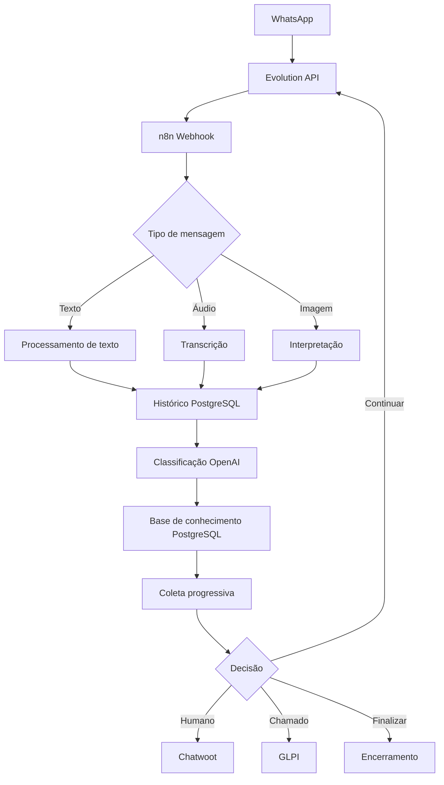
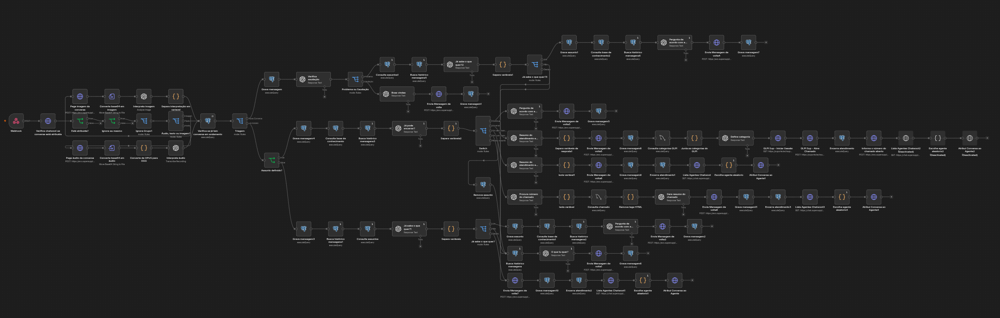

# Glados — Assistente Virtual de TI com n8n

Automação para o atendimento inicial do Departamento de TI. O workflow recebe mensagens pelo WhatsApp, interpreta texto, áudio e imagem, consulta o histórico e a base de conhecimento, conversa com o usuário e pode encaminhar o caso a uma pessoa ou abrir um chamado no GLPI.

## Fluxo geral

O Chatwoot participa dos encaminhamentos humanos e da atribuição da conversa a agentes. Consulte [docs/arquitetura.md](docs/arquitetura.md) e [docs/fluxo-atendimento.md](docs/fluxo-atendimento.md).

## Workflow no n8n

[Baixar a imagem em resolução original](docs/images/workflow-glados.png) · [Baixar o workflow JSON](workflows/glados-autoatendimento.json)

## Base de conhecimento

Este projeto tem dependência lógica do repositório [kb_glados_dti](https://github.com/Sipauba/kb_glados_dti). Este repositório contém a automação e orquestração; o outro contém o conteúdo e as regras da base de conhecimento. Ela define assuntos, informações necessárias, ordem de coleta e quando continuar perguntando, encerrar, abrir chamado ou encaminhar para uma pessoa.

O workflow consulta esses dados no PostgreSQL, nas tabelas `bot_atendimento_ti.base_conhecimento` e `bot_atendimento_ti.atendimento`. Mudanças no schema ou nas regras podem afetar o comportamento deste projeto. Consulte [docs/base-conhecimento.md](docs/base-conhecimento.md).

## Estrutura

- `workflows/glados-autoatendimento.json`: export sanitizado do workflow n8n.
- `docs/`: arquitetura, fluxo, integrações, segurança, base de conhecimento e melhorias futuras.
- `database/`: estruturas observadas e exemplos fictícios sem dump de dados.
- `.env.example`: nomes de configuração sem valores reais.

## Importação e configuração

Importe o JSON em uma instância n8n compatível e recrie/selecione as Credentials descritas em [docs/integracoes.md](docs/integracoes.md). Configure endpoints e bancos conforme o ambiente. O workflow usa nodes nativos, nodes OpenAI/LangChain e Code nodes com `ffmpeg` para converter áudio. Confirme os nodes necessários e o executável no ambiente de execução.

Não inclua dados reais de usuários em exemplos ou commits. Consulte [docs/seguranca.md](docs/seguranca.md).
