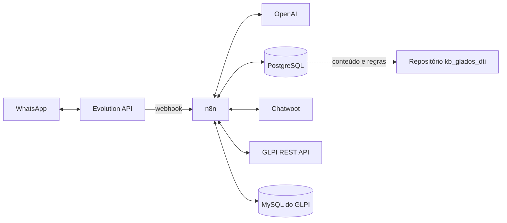

# Arquitetura

O n8n coordena entrada, interpretação, persistência e encaminhamento. O workflow começa no node `Webhook` e usa nodes Postgres, MySQL, HTTP Request, OpenAI/LangChain e Code.

- **n8n:** orquestra as decisões; recebe eventos pelo webhook `autobot`.
- **Evolution API:** recebe eventos WhatsApp, envia respostas e recupera mídias em base64.
- **OpenAI:** classifica solicitações, interpreta imagem/áudio, formula perguntas, avalia encerramento e resume chamados. O export identifica `gpt-6-luna` e `gpt-4.1-mini`.
- **PostgreSQL:** guarda histórico em `bot_atendimento_ti.atendimento` e fornece assuntos/instruções em `bot_atendimento_ti.base_conhecimento`.
- **Chatwoot:** verifica estado da conversa, lista agentes e atribui atendimentos humanos.
- **GLPI:** consulta categorias/chamados e cria chamados pela API REST. O workflow também lê dados via MySQL.
- **Base externa:** o repositório `kb_glados_dti` contém um painel Flask para manter `bot_atendimento_ti.base_conhecimento` via API REST do Supabase. O workflow n8n lê a tabela compartilhada diretamente por PostgreSQL. Veja [base-conhecimento.md](base-conhecimento.md).

Endpoints e URLs de serviço aparecem no workflow e devem ser revisados para o ambiente alvo. Tokens foram substituídos no export sanitizado.
